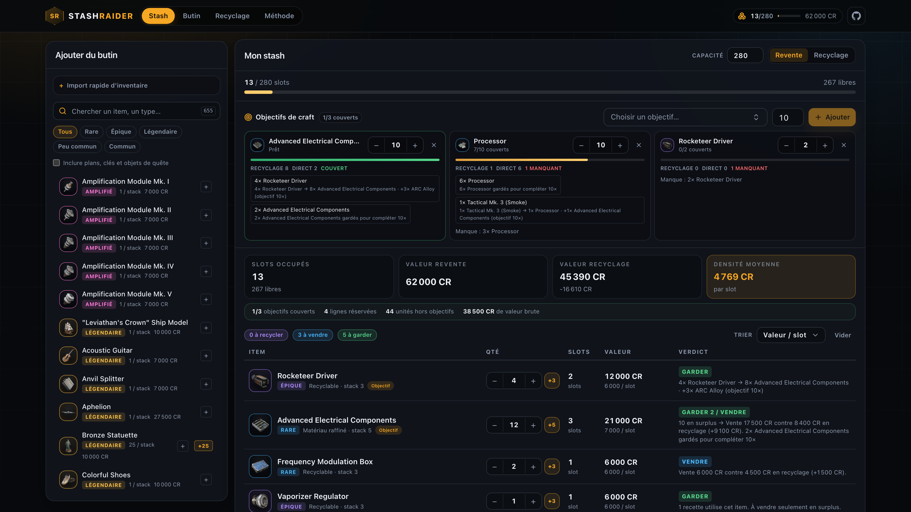
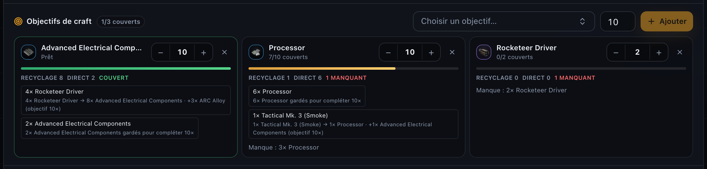

# StashRaider

Optimiseur de stash pour **Arc Raiders**. Il répond à quatre questions :

**Site en ligne : [ozakione.github.io/stashraider](https://ozakione.github.io/stashraider/)**

1. **Je garde ou je recycle ?** Chaque ligne du stash est valorisée à la revente et au
   recyclage, avec les rendements actuels et la place réellement consommée.
2. **Quels composants ou objets je prépare ?** Les objectifs réservent les sources
   recyclables les plus rentables en place, puis le composant direct. Pour une arme ou un
   équipement, la recette est dépliée récursivement jusqu'aux composants de base.
3. **Qu'est-ce que je ramène du raid ?** Les candidats sont classés à la valeur par slot,
   avec la place libre restante et un plan de transfert vers le stash.
4. **Quel item recycler pour obtenir ce matériau ?** La recherche inversée classe les
   sources par place nécessaire et par rendement par slot, avec le coût d'opportunité.





## Ce que le site calcule

- `slots = ⌈quantité ÷ stack⌉`, un stack partiel occupe un slot entier.
- Valeur de revente = `prix × quantité`.
- Valeur de recyclage = somme des sorties, valorisées au prix de vente wiki.
- Verdict : recycler si le rendement dépasse la vente de plus de 8 %, garder les items
  rares utilisés en craft, vendre sinon.
- Objectifs : une source recyclable est réservée si son rendement par slot dépasse le
  stack du composant direct. Sinon le composant direct passe d'abord. Le reste du stack
  est du surplus, avec sa valeur de sortie.
- Recettes : pour un objet craftable, la recette est dépliée récursivement. Les ingrédients
  directs sont réservés avant les sources recyclables et les sous-recettes. Les manques
  sont listés jusqu'aux composants de base. Exemple : objectif `Wolfpack 1` → réserver
  `1 Explosive Compound`, `2 ARC Motion Core` et `1 Rocketeer Driver` ; objectif
  `Venator I 1` → `2 Advanced Mechanical Components`, `3 Medium Gun Parts`, `5 Magnet`.
- Import d'inventaire : une ligne par item, quantité avant ou après le nom, par exemple
  `12 Advanced Electrical Components` ou `Rocketeer Driver x4`.
- Ajout rapide : un clic ajoute 1 unité, le bouton `+5` (ou la taille du stack) ajoute
  une pile complète depuis la recherche, une ligne du stash ou la fiche item.
- Recherche inversée : `items = ⌈besoin ÷ rendement⌉` puis `slots = ⌈items ÷ stack⌉`.

Les prix, stacks, rendements de recyclage et recettes viennent des tables Cargo
de la [wiki ARC Raiders](https://arcraiders.wiki), complétées par les pages d'armes pour
les variantes et leurs recettes. Les icônes sont copiées en local pour que l'interface
reste rapide.

## Lancer en local

```bash
pnpm install
pnpm dev
```

Sur une machine sans `node` dans le `PATH`, passer les scripts par `nub` :

```bash
nub run dev
nub run test
nub run build
```

L'interface utilise Tailwind CSS v4 et les composants shadcn/ui (`button`, `combobox`,
`dialog`, `select`, `tabs`…). Les composants sont versionnés dans `src/components/ui/`
et se modifient directement sur place.

## Mettre les données à jour

```bash
pnpm data:update
```

La commande utilise Bun et interroge les tables `items`, `recycling` et `crafting` de la
wiki. Elle :

- télécharge les nouvelles icônes dans `public/icons/` (les fichiers déjà présents sont
  réutilisés) ;
- régénère `src/data/catalog.json` avec les prix, stacks, rendements et recettes ;
- vérifie au passage le rendement du Rocketeer Driver dans la sortie de console.

Le workflow `Sync game data` relance cette synchronisation chaque lundi et commit les
changements. Après un patch, lancer aussi la commande manuellement avant de publier.

## Vérifications

```bash
pnpm lint:check
pnpm test
pnpm build
```

`lint:check` exécute Oxlint avec le type checking et l'analyse type-aware. Les tests
couvrent le calcul de slots, les verdicts, la recherche inversée et le plan de recyclage.

## Déploiement

Le workflow `Deploy to GitHub Pages` construit et publie `dist/` à chaque push sur
`main`. Le site est statique, sans serveur ni compte : le stash est conservé dans le
`localStorage` du navigateur.

## Limites connues

- La wiki est communautaire, pas une API officielle Embark.
- Le craft est signalé mais pas valorisé en crédits.
- Le salvage n'est pas pris en compte : seuls les rendements de recyclage comptent.
- Les armes sont lues depuis les pages wiki (26 armes, 92 variantes), pas depuis la table
  Cargo. Les blueprints ne sont pas vérifiés : le plan suppose la recette apprise.
- Les noms d'objets en double côté wiki (trois variantes de « Colorful Shoes ») sont
  conservés comme trois entrées distinctes.

Outil communautaire non officiel. Arc Raiders est une marque d'Embark Studios. Les
données textuelles de la wiki sont sous CC BY-SA ; les assets du jeu restent la propriété
d'Embark Studios.
